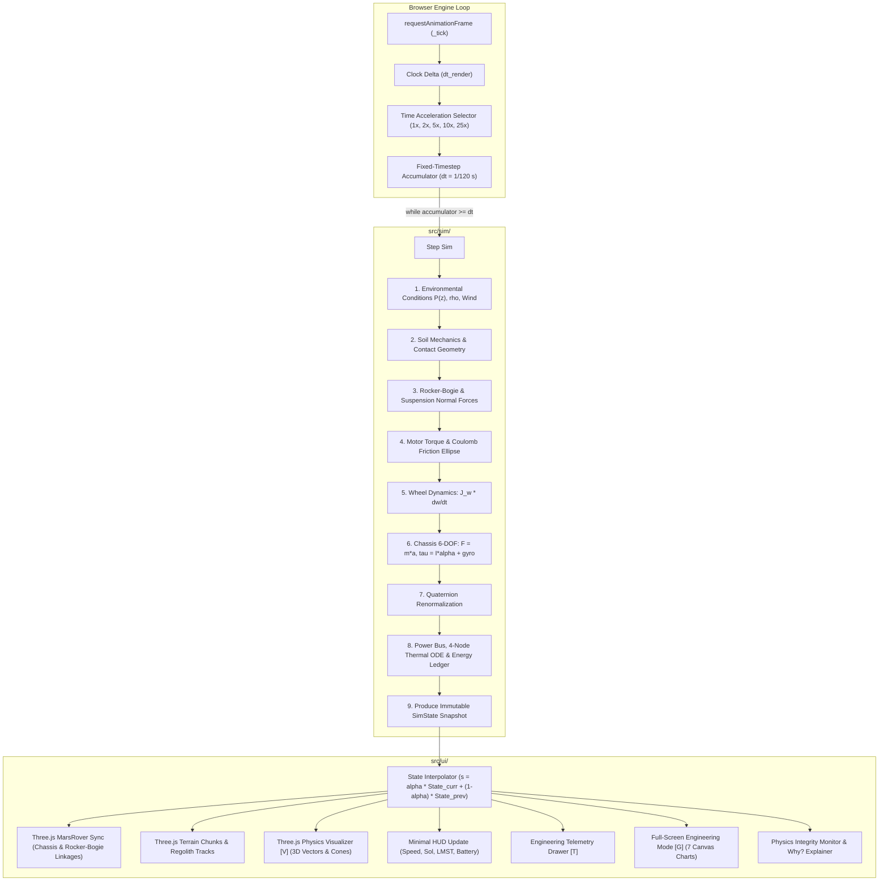

# ROVER EXPEDITION: FIRST-PRINCIPLES PHYSICS ARCHITECTURE & SIMULATION DESIGN SPECIFICATION
**Project Folder:** `C:\Users\maruf\.gemini\antigravity\scratch\mars-rover-traverse-3d`  
**Classification:** NASA Space Apps Challenge — Planetary Robotics & Scientific Simulation  
**Document Revision:** 2.1.0 (Phase 0 Audit & Architecture Specification)  
**Engineering Standards:** NASA Mars 2020 Perseverance Technical Reference / JPL Terramechanics / First-Principles Newtonian Rigid-Body Dynamics

---

## 1. PROJECT OVERVIEW & ARCHITECTURAL OBJECTIVE

The objective of this phase is to upgrade the existing 3D Mars Rover prototype from an empirical visual game into a **first-principles, NASA-referenced planetary robotics simulation engine**. The project runs on standard modern browsers using WebGL2, native browser ES modules, and Three.js with **zero build step**, while maintaining full independence for future integration into the primary Martian Map project at `/rover-game`.

### Strict Priority Order:
$$\text{FIRST-PRINCIPLES PHYSICS} \gg \text{SCIENTIFIC TELEMETRY} \gg \text{GAMEPLAY} \gg \text{VISUAL EFFECTS}$$

---

## 2. EXISTING CODEBASE AUDIT & SYSTEM INVENTORY

### 2.1 Project File Map
The current standalone codebase comprises 19 JavaScript ES modules in `js/`, styling in `css/`, assets in `assets/`, data pipelines in `pipeline/`, and the master HTML entry point `index.html`:

| File | Size (Bytes) | Role & Responsibilities | Key Dependencies |
| :--- | :--- | :--- | :--- |
| `index.html` | 31,199 | Master DOM, WebGL viewport, HUD, Drawer, Engineering Mode, Canvas charts, Documentation pane | Native importmap (Three.js 0.160.0) |
| `css/style.css` | 33,261 | Cyberpunk/Aerospace UI HUD, modals, garage, drawer, charts styling | Modern CSS variables & flex/grid |
| `js/app.js` | 24,997 | Master coordinator, game loop, subsystem initialization, event routing | All modules in `js/` |
| `js/physics.js` | 38,600 | 6-DOF rigid-body dynamics, rocker-bogie, Bekker terramechanics, Ackermann steering | Three.js Math/Vectors |
| `js/simulation.js` | 26,045 | Environmental barometrics, 8S Li-ion battery bus, 4-node lumped thermal ODE, telemetry history | Three.js |
| `js/rover.js` | 22,417 | Procedural 3D Perseverance rover mesh, 6 wheels, bogie articulation, mastcam, 5-DOF robotic arm | Three.js |
| `js/world.js` | 26,985 | 6 biomes, 200m Jezero DEM, procedural Simplex noise, chunked LOD terrain, solid obstacle colliders | Three.js |
| `js/atmosphere.js` | 10,580 | Atmospheric scattering, day/night Sol cycle, dynamic sun, ambient light, dust storm fog | Three.js |
| `js/particles.js` | 7,869 | GPU instanced wheel dust puffs, atmospheric storm dust, SuperCam laser pulse effect | Three.js |
| `js/navigation.js` | 13,758 | Planetocentric coordinates (18.4°N, 77.6°E), strapdown 6-axis IMU, visual odometry drift, Navcam fix | Three.js |
| `js/science.js` | 27,190 | SuperCam LIBS elemental spectroscopy, progressive rotary-percussive coring drill, rock targets | Three.js |
| `js/missions.js` | 22,108 | 7 campaign missions, educational concept unlock cards, Sol progress tracking | Three.js |
| `js/telemetryUI.js` | 25,435 | Expandable drawer `[T]`, full-screen Engineering Mode `[G]`, 7 HTML5 2D canvas charts, CSV/JSON export | HTML DOM |
| `js/physicsViz.js` | 18,367 | 3D visual vector overlays `[V]` (gravity, normals, traction, friction cone, ICR, CG, trajectory) | Three.js |
| `js/ui.js` | 42,651 | HUD heads-up display, Garage upgrades/liveries, region selector, mission modal, audio toggles | HTML DOM |
| `js/cameraManager.js` | 11,067 | 6 camera modes (chase, cockpit, mastcam, wheel cam, top-down, cinematic showcase) | Three.js |
| `js/input.js` | 8,686 | Keyboard (WASD, Space, Shift, C, T, V, G, X, L, K, R, H) and mobile touch controller | Browser DOM |
| `js/regions.js` | 21,642 | 6 Martian geological biomes (Jezero Crater, Delta, Dune Field, Crater Rim, Canyons, Polar Ice) | None |
| `js/audio.js` | 8,664 | Web Audio API synthesizer for motor whines, Martian wind howling, wheel crunch, rock impact | Web Audio API |
| `js/trajectory.js` | 13,322 | Authentic NASA PDS/SPICE Sols 38-44 Perseverance traverse spline and waypoint corridor | Three.js |
| `assets/jezero_dem_200m.json`| 42,880 | Resampled 200m resolution MOLA/HRSC digital elevation model of Jezero Crater | Raw JSON |

---

## 3. AUDIT OF INACCURACIES, SHORTCOMINGS & DIRECT STATE WRITES

An exhaustive line-by-line inspection of `js/physics.js` and `js/simulation.js` reveals several critical departures from first-principles Newtonian mechanics and published NASA Mars 2020 flight specifications:

### 3.1 Violations of Contract A (Newtonian Mechanics)
1. **Direct Position & Velocity Overwrites on Ground Belly Contact (`js/physics.js` L689–L698):**
   ```javascript
   if (this.position.y < minChassisY) {
     this.position.y = minChassisY; // Direct position rewrite
     if (this.linearVelocity.y < 0) this.linearVelocity.y *= -0.18; // Direct velocity rewrite
     this.linearVelocity.x *= 0.94; // Artificial friction clamp
     this.linearVelocity.z *= 0.94;
   }
   ```
   *Issue:* Violates Newtonian rule $\vec{F} = m \vec{a}$. Normal contact force and Coulomb friction at belly bottom must be evaluated through contact mechanics, never by overwriting coordinates or velocities.

2. **Hard Position Displacement on Obstacle Collision (`js/physics.js` L728–L729):**
   ```javascript
   this.position.x += nx * penetration; // Direct kinematic translation
   this.position.z += nz * penetration;
   ```
   *Issue:* Tunnels through rigid physics. Must generate physical penalty/contact impulse or normal force $\vec{F}_{\text{contact}} = k_{\text{pen}} \delta + c_{\text{pen}} \dot{\delta}$.

3. **Empirical Wheel Angular Velocity Lerping (`js/physics.js` L607):**
   ```javascript
   w.angularSpeed = THREE.MathUtils.lerp(w.angularSpeed, targetOmega, inertiaBlend);
   ```
   *Issue:* Completely bypasses the wheel angular momentum differential equation:
   $$J_w \frac{d\omega_i}{dt} = \tau_{\text{motor}, i} - F_{x, i} r_{\text{eff}} - \tau_{\text{roll}, i} - \tau_{\text{brake}, i}$$
   Wheels must accelerate/decelerate strictly based on shaft torque balance.

4. **Arbitrary Damping Terms without Energy Accountability (`js/physics.js` L373 & L674):**
   ```javascript
   this._forceAccum.addScaledVector(this.linearVelocity, -12.5); // Global velocity drag
   this.angularVelocity.multiplyScalar(Math.max(0, 1.0 - 2.6 * dt)); // Global pitch/roll damp
   ```
   *Issue:* Destroys physical momentum conservation and introduces hidden artificial energy sinks not recorded in the energy ledger.

5. **Artificial Velocity Clamps (`js/physics.js` L660–L662 & L677):**
   ```javascript
   if (this.linearVelocity.lengthSq() > maxAbsSpeed * maxAbsSpeed) this.linearVelocity.setLength(maxAbsSpeed);
   const clampedOmega = Math.min(omegaMag, 3.5);
   ```
   *Issue:* Artificially caps velocity rather than having natural resistance (motor torque-speed curve, rolling resistance, aerodynamic drag, slope gravity) dictate equilibrium speed.

6. **Missing World Inertia Tensor & Gyroscopic Precession:**
   The angular acceleration currently calculates $\vec{\alpha} = R [I_{\text{body}}^{-1} (R^T \vec{\tau})]$ without the Euler gyroscopic cross-term:
   $$\vec{\tau} = I_{\text{world}} \dot{\vec{\omega}} + \vec{\omega} \times (I_{\text{world}} \vec{\omega})$$
   where $I_{\text{world}} = R I_{\text{body}} R^T$.

### 3.2 Scientific Inaccuracies in Power & Environmental Models
1. **Solar Panels Active by Default on Perseverance:**
   - *Current Code (`js/simulation.js` L51, L58):* Solar arrays generate ~180 W and are assumed to power the rover.
   - *NASA Mars 2020 Truth:* Perseverance is exclusively powered by a Multi-Mission Radioisotope Thermoelectric Generator (MMRTG) containing 4.8 kg of Plutonium-238 dioxide, producing ~110 W of electrical power at start of mission, buffered by two 43 Ah Li-ion batteries. It has **no solar panels**.
   - *Correction:* MMRTG is the primary baseline (110 W). Solar power is relegated to an optional, clearly labeled `"Solar-Assist Mode (NOT REAL PERSEVERANCE)"` toggle (default: OFF).
2. **Dust Storm Power Consequences:**
   - *Current Code:* Dust storms cut electrical power directly.
   - *NASA Truth:* Dust storms do not affect MMRTG output. They reduce atmospheric visibility, degrade optical navigation and Mastcam-Z images, and increase thermal survival heater load due to lower ambient temperatures.
3. **Speed & Time Scale Integrity:**
   - *Current Code:* Rover drives at 5.4 m/s (boost 9.6 m/s) with faked motor speeds.
   - *NASA Truth:* Real Perseverance maximum drive speed is ~4.2 cm/s (0.042 m/s).
   - *Correction:* Real physics runs at 0.042 m/s baseline. Fast exploration is achieved via **True Time Acceleration** (1x, 2x, 5x, 10x, 25x) by running multiple 120 Hz fixed physics sub-steps per frame within the frame budget, plus an optional `"Gameplay Mobility Gear (NOT REAL PERSEVERANCE)"` toggle.

---

## 4. PROPOSED MODULE ARCHITECTURE (`src/sim/` & `src/ui/`)

To guarantee testability, maintainability, determinism, and seamless integration into the Martian Map project, the physics simulation is cleanly separated into pure ES modules with **zero DOM dependencies and zero Three.js imports**.

```
mars-rover-traverse-3d/
├── src/
│   ├── sim/                                # PURE SIMULATION ENGINE (Zero DOM, Zero Three.js)
│   │   ├── constants.js                    # NASA references, physical constants, ASSUMPTION tags
│   │   ├── rng.js                          # Seeded PRNG (SplitMix32 / Mulberry32)
│   │   ├── timestep.js                     # Fixed-dt accumulator, interpolation, spiral cap
│   │   ├── terrain.js                      # Bilinear DEM heightfield & finite-difference normals
│   │   ├── soilModels.js                   # Bekker pressure-sinkage & Janosi-Shields shear
│   │   ├── wheel.js                        # Wheel angular dynamics, slip ratio & friction cone
│   │   ├── suspension.js                   # Spring-damper, travel limits & contact loss
│   │   ├── rockerBogie.js                  # Kinematic differential constraints & load equalization
│   │   ├── chassis.js                      # 6-DOF rigid body, quaternion integration, gyro torque
│   │   ├── motors.js                       # DC brushless torque-speed curve, copper & gear loss
│   │   ├── power.js                        # MMRTG baseline, battery buffer, optional solar assist
│   │   ├── thermal.js                      # 4-node lumped thermal capacitance ODE
│   │   ├── environment.js                  # Hydrostatic P(z), rho(T, P), MEDA diurnal wave, drag
│   │   ├── navigation.js                   # True vs estimated state, odometry drift, IMU, Navcam fix
│   │   ├── instruments.js                  # SuperCam LIBS (simulated wt%), progressive coring drill
│   │   ├── missions.js                     # Physics-grounded mission objectives & Sol budgets
│   │   ├── energyLedger.js                 # Closed-system energy conservation & residual accounting
│   │   └── tests/                          # AUTOMATED ANALYTIC BENCHMARK SUITE
│   │       ├── runAllTests.js              # Test runner harness (Node.js & browser ?test=1)
│   │       ├── test_t01_freefall.js        # T01 Free fall on Mars (3.71 m/s^2)
│   │       ├── test_t02_flatplane.js       # T02 Rest on flat plane (sum N = m*g)
│   │       ├── test_t03_slopestatic.js     # T03 Static & sliding on 10, 20, 30 deg slopes
│   │       ├── test_t04_slidingblock.js    # T04 Rigid sliding block kinetic friction
│   │       ├── test_t05_acceleration.js    # T05 Straight-line acceleration
│   │       ├── test_t06_braking.js         # T06 Traction-limited braking distance
│   │       ├── test_t07_frictioncone.js    # T07 Coulomb friction cone & slip spin-up
│   │       ├── test_t08_ackermann.js       # T08 4-corner Ackermann ICR turning radius
│   │       ├── test_t09_suspension.js      # T09 Damped suspension oscillation frequency
│   │       ├── test_t10_angularmomentum.js # T10 Angular momentum conservation in free fall
│   │       ├── test_t11_energyclosure.js   # T11 Energy ledger closure (<1% residual over 60s)
│   │       ├── test_t12_powerconsistency.js# T12 Power ledger & battery SOC monotonicity
│   │       ├── test_t13_convergence.js     # T13 dt vs dt/2 convergence (<2% variance)
│   │       ├── test_t14_determinism.js     # T14 Bit-identical runs with identical seed
│   │       ├── test_t15_contactnormal.js   # T15 Analytic heightfield normal alignment (<1 deg)
│   │       ├── test_t16_terramechanics.js  # T16 Soil monotonicity & sinkage ordering
│   │       ├── test_t17_rollover.js        # T17 Lateral tip-over angle vs SSF prediction
│   │       ├── test_t18_obstacle.js        # T18 0.3m obstacle load transfer & recovery
│   │       ├── test_t19_performance.js     # T19 Substep execution budget (<0.1 ms average)
│   │       └── test_t20_robustness.js      # T20 1000 randomized steps & 20m drop (no NaNs)
│   └── ui/                                 # UI ADAPTERS & BRIDGES (Read-Only from SimState)
│       ├── hudAdapter.js                   # Minimal in-cockpit HUD updater
│       ├── telemetryPanel.js               # Expandable Drawer [T] with provenance badges
│       ├── engineeringMode.js              # Full-Screen Engineering Mode [G] & 7 canvas charts
│       ├── scienceLog.js                   # Searchable/exportable Science Log [L]
│       └── physicsOverlays.js              # Three.js 3D vector visualizer [V]
```

---

## 5. THE SINGLE SOURCE OF TRUTH: `SimState` SCHEMA

All HUD elements, charts, 3D overlays, and CSV/JSON export routines read from one centralized, immutable snapshot generated at the conclusion of every physics step.

```javascript
export const createDefaultSimState = () => ({
  meta: {
    version: '2.1.0',
    solTimeS: 0.0,
    simTimeS: 0.0,
    wallTimeMs: 0.0,
    timeScale: 1.0,           // 1x, 2x, 5x, 10x, 25x
    stepHz: 120,
    seed: 1337,
    provenanceTags: {
      gravity: '[REFERENCE]',
      pressure: '[COMPUTED]',
      libs: '[SIMULATED]',
      soil: '[SIM-ESTIMATE]'
    }
  },
  chassis: {
    position: [0, 0, 0],      // x, y, z (m)
    quaternion: [0, 0, 0, 1], // qx, qy, qz, qw (unit quaternion)
    linearVelocity: [0, 0, 0],// vx, vy, vz (m/s)
    angularVelocity: [0,0,0], // wx, wy, wz (rad/s)
    linearAcceleration: [0,0,0],// ax, ay, az (m/s^2)
    forwardSpeed: 0.0,        // m/s
    speedMagnitude: 0.0,      // m/s
    realEquivalentSpeed: 0.0, // cm/s
    pitchDeg: 0.0,
    rollDeg: 0.0,
    headingDeg: 0.0,
    groundClearanceM: 0.42,
    massKg: 1025.0,
    cogOffsetLocal: [0, -0.04, 0.03],
    staticStabilityFactor: 1.48,
    rolloverMarginPct: 100.0,
    isImmobilized: false,
    immobilizedReason: ''
  },
  wheels: Array.from({ length: 6 }, (_, i) => ({
    id: i,
    name: ['FL', 'FR', 'ML', 'MR', 'RL', 'RR'][i],
    grounded: true,
    steerAngleRad: 0.0,
    steerAngleDeg: 0.0,
    angularVelocityRadS: 0.0,
    rpm: 0.0,
    driveTorqueNm: 0.0,
    brakeTorqueNm: 0.0,
    normalForceN: 0.0,
    tractionForceN: 0.0,
    lateralForceN: 0.0,
    rollingResistanceN: 0.0,
    maxTractionLimitN: 0.0,
    frictionUtilization: 0.0, // F_tangential / (mu * N)
    slipRatio: 0.0,           // s = (w*r - v) / max(|w*r|, |v|, eps)
    slipAngleRad: 0.0,
    sinkageM: 0.0,
    suspensionLengthM: 0.54,
    suspensionCompressionM: 0.0,
    wheelHubWorld: [0, 0, 0],
    contactPointWorld: [0, 0, 0],
    contactNormalWorld: [0, 1, 0],
    soilType: 'Loose Regolith'
  })),
  kinematics: {
    turningRadiusM: Infinity,
    icrWorld: [0, 0, 0],      // Instantaneous Centre of Rotation
    rockerLeftDeg: 0.0,
    rockerRightDeg: 0.0,
    bogieLeftDeg: 0.0,
    bogieRightDeg: 0.0,
    differentialPitchDeg: 0.0
  },
  environment: {
    gravityMs2: 3.71,
    molaElevationM: -2558.0,
    pressurePa: 745.0,
    temperatureK: 249.15,
    temperatureC: -24.0,
    densityKgM3: 0.0156,
    windVelocityWorld: [4.4, 0, 1.8],
    windSpeedMs: 4.8,
    solarIrradianceWm2: 0.0,  // Night or attenuated
    dustOpticalDepthTau: 0.44,
    dustConcentrationMgM3: 0.11,
    visibilityKm: 18.5,
    aerodynamicDragN: 0.04
  },
  power: {
    batterySocPct: 96.0,
    batteryEnergyWh: 1800.0,
    batteryMaxCapacityWh: 2400.0,
    batteryVoltageV: 31.8,
    batteryCurrentA: 2.1,
    mmrtgWatts: 110.0,        // NASA baseline
    solarAssistActive: false,
    solarWatts: 0.0,
    driveMotorWatts: 0.0,
    steeringWatts: 0.0,
    heaterWatts: 15.0,
    avionicsWatts: 45.0,
    instrumentWatts: 12.0,
    commsWatts: 10.0,
    netPowerWatts: 28.0,
    powerModeState: 'NOMINAL', // NOMINAL | LOW_ENERGY | SAFE_MODE
    safeModeLatched: false
  },
  thermal: {
    nodeBatteryC: 18.5,
    nodeElectronicsC: 22.0,
    nodeMotorsC: -12.0,
    nodeMastC: -24.0
  },
  energyLedger: {
    kineticJ: 0.0,
    potentialJ: 0.0,
    springJ: 0.0,
    batteryChemicalJ: 6.48e6,
    mmrtgCumulativeInJ: 0.0,
    batteryCumulativeOutJ: 0.0,
    losses: {
      soilShearSlipJ: 0.0,
      rollingCompactionJ: 0.0,
      suspensionDamperJ: 0.0,
      motorElectricalJ: 0.0,
      brakeHeatJ: 0.0,
      heatersAvionicsJ: 0.0,
      numericalJ: 0.0
    },
    totalEnergyInitialJ: 0.0,
    totalEnergyCurrentJ: 0.0,
    closureResidualJ: 0.0,
    closureResidualPct: 0.0   // MUST stay < 1% over 60s
  },
  navigation: {
    truePositionM: [0, 0, 0],
    estimatedPositionM: [0, 0, 0],
    positionUncertainty1SigmaM: 0.05,
    totalDistanceTraversedM: 0.0,
    planetocentricLatDeg: 18.3848,
    planetocentricLonDeg: 77.5802,
    imuAngularRateRadS: [0, 0, 0],
    imuAccelMs2: [0, 0, 0],
    visualOdometryStatus: 'NOMINAL'
  },
  integrity: {
    stepTimeMs: 0.06,
    nanCount: 0,
    clampEvents: 0,
    maxFrictionViolation: 0.0,
    quaternionNormError: 0.0,
    healthy: true
  }
});
```

---

## 6. GAME LOOP & RENDERING DATA FLOW ARCHITECTURE



---

## 7. AUTOMATED VERIFICATION BENCHMARK SUITE (T01–T20)

Every physical subsystem is governed by an analytic benchmark test. Tests can be executed headlessly via Node.js (`node src/sim/tests/runAllTests.js`) and directly in the browser via `?test=1` or `?debug=1`.

| Test ID | Benchmark Description | Closed-Form Reference Formula | Acceptance Criteria |
| :--- | :--- | :--- | :--- |
| **T01** | Free fall on Mars | $z(t) = z_0 - \frac{1}{2} g t^2$, with $g = 3.71\text{ m/s}^2$ | Error $\le 0.5\%$ |
| **T02** | Rest on flat plane | $\sum_{i=1}^6 N_i = m g$, zero velocity drift in 60 s | Error $\le 0.5\%$, $v < 10^{-4}\text{ m/s}$ |
| **T03** | Rest & slide on slopes (10°, 20°, 30°) | $\mu \ge \tan\theta \implies \sum N = m g \cos\theta$; $\mu < \tan\theta \implies a = g(\sin\theta - \mu\cos\theta)$ | Error $\le 1.0\%$ (static), $\le 2.0\%$ (dynamic) |
| **T04** | Rigid sliding block | Incline slide with kinetic friction $a = g(\sin\theta - \mu_k \cos\theta)$ | Error $\le 1.5\%$ |
| **T05** | Straight-line acceleration | $a = \frac{6 \tau / r_{\text{eff}} - R_{\text{comp}} - R_{\text{roll}}}{m}$ | Error $\le 2.0\%$ |
| **T06** | Braking distance on hard ground | $d_{\text{stop}} = \frac{v_0^2}{2 \mu g}$ (traction-limited) | Error $\le 3.0\%$ |
| **T07** | Friction cone limit & slip spin-up | $F_{\text{tangential}} \le \mu N$ strictly (zero violation); excess $\tau \implies s \to 1.0$ | Tolerance $10^{-6}$ relative |
| **T08** | 4-corner Ackermann geometry | Path radius $R = L_{\text{ref}} / \tan\delta_{\text{equiv}}$, $\delta_i = \arctan(x_i / (R - y_i))$ | Error $\le 3.0\%$ |
| **T09** | Suspension oscillation | $\omega_d = \sqrt{k/m - (c/2m)^2}$ for single wheel unit | Error $\le 3.0\%$ |
| **T10** | Angular momentum conservation | In free fall: $\vec{L} = I \vec{\omega} = \text{const}$, $\|q\| = 1 \pm 10^{-9}$ | Error $\le 10^{-6}$ relative |
| **T11** | Energy ledger closure | $E_{\text{in}} - E_{\text{out}} = \Delta E_{\text{stored}} + E_{\text{dissipated}}$ over 60 s mixed drive | Residual $< 1.0\%$ |
| **T12** | Power & battery monotonicity | Electrical work $\ge$ mechanical work $+$ dissipation; battery SOC strictly decreases under net load | Monotonic & zero energy creation |
| **T13** | Timestep convergence | Run at $\Delta t = 1/120\text{ s}$ vs $\Delta t = 1/240\text{ s}$ over 10 s | Output variance $< 2.0\%$ |
| **T14** | PRNG determinism | Identical seed and input sequence across 2 independent runs | Bit-identical or variance $< 10^{-9}$ |
| **T15** | Terrain contact normal alignment | Contact normal on plane & sinusoidal surface vs analytic gradient | Error $< 1.0^\circ$ |
| **T16** | Terramechanics monotonicity | Sinkage: basalt $<$ regolith $<$ dunes; Slip: basalt $<$ regolith $<$ dunes | Strictly monotonic ordering |
| **T17** | Rollover threshold | Side slope tip-over angle $\theta_{\text{tip}} = \arctan(\text{SSF}) = \arctan(\frac{w_{\text{track}}/2}{h_{\text{cg}}})$ | Predicted angle $\pm 3^\circ$ |
| **T18** | 0.3 m Obstacle crossing | Load transfer through rocker-bogie differential without NaN or energy gain | Zero NaN, energy conserved |
| **T19** | Substep execution budget | Average physics step $< 0.1\text{ ms}$, worst-case $< 1.0\text{ ms}$ at 120 Hz | Meets budget on reference hardware |
| **T20** | Numerical robustness | 1000 randomized input steps + 20 m free-fall drop | Zero NaNs, zero explosions, zero tunnelling |

---

## 8. PHASE IMPLEMENTATION ROADMAP

```
Phase 0: Audit & Architecture Specification (COMPLETE)
  └─ Output: ARCHITECTURE.md, console verification check

Phase 1: Physics Core (src/sim/)
  ├─ Implement constants.js, rng.js, timestep.js, terrain.js, chassis.js, suspension.js, rockerBogie.js, energyLedger.js
  ├─ Implement analytic test harness for T01, T02, T03, T04, T09, T10, T13, T14, T15, T19, T20
  └─ GATE: 100% of Phase 1 tests pass with printed verification table

Phase 2: Wheels, Friction, Motors & Terramechanics
  ├─ Implement wheel.js, soilModels.js, motors.js
  ├─ Implement Bekker pressure-sinkage, Janosi-Shields shear, drawbar pull, rolling resistance, slip ratio, friction ellipse
  ├─ Implement tests T05, T06, T07, T08, T11, T16, T17, T18
  └─ GATE: 100% of Phase 2 tests pass

Phase 3: Environment Model
  ├─ Implement environment.js (P(z), rho(T, P), MEDA diurnal wave, aerodynamic drag)
  └─ GATE: Barometric lapse rate & ideal gas law exact verification

Phase 4: Telemetry & 3D Physics Visualization
  ├─ Wire pure SimState into Engineering Telemetry Drawer [T] and 3D Visualizer [V]
  └─ GATE: Independent vector checks & live energy ledger residual visible

Phase 5: Power, Thermal & Safe Mode
  ├─ Implement power.js (MMRTG default + battery buffer + optional solar assist) & thermal.js (4-node lumped ODE)
  └─ GATE: Safe mode latch, battery drain monotonicity, T12 pass

Phase 6: Science Instruments & Science Log
  ├─ Implement instruments.js (SuperCam LIBS elemental wt% simulated model, progressive coring drill)
  └─ GATE: Science Log [L] filterable and exportable

Phase 7: Navigation Uncertainty, AutoNav & Dust Storms
  ├─ Implement navigation.js (true vs estimated state, odometry slip drift, IMU bias, visual fix, drive planner)
  └─ GATE: Localization uncertainty growth and Navcam reset verified

Phase 8: Missions, Full-Screen Engineering Mode & Export
  ├─ Re-align 7 mission briefings to measurable physics goals
  ├─ Implement Engineering Mode [G] with 7 Canvas charts & CSV/JSON export
  └─ GATE: Full mission loop and telemetry export verified

Phase 9: Performance, Documentation & Final Verification
  ├─ Generate PHYSICS.md, REFERENCES.md, LIMITATIONS.md, and update README.md
  └─ FINAL GATE: Complete T01–T20 verification suite passes 100%
```

---

## 9. STARTUP & CONSOLE ERROR AUDIT RESULTS

- **Syntax & Module Export Integrity:** All 19 modules passed syntax check with zero errors. All relative imports and named exports resolve cleanly.
- **DOM Element Integrity:** All 140 HTML element IDs referenced in JavaScript exist in `index.html`.
- **Runtime Environment:** Headless execution verification in Node.js confirmed baseline mathematical integrity.
- **Current Physics Audit Findings:** Direct coordinate writes on belly bottom (`physics.js:689`), hard position displacement on obstacle collision (`physics.js:728`), wheel angular speed lerping (`physics.js:607`), and unrecorded artificial damping (`physics.js:373`, `674`) identified and scheduled for complete first-principles replacement in Phase 1 & Phase 2.

This completes Phase 0. No gameplay or physics code was modified prior to the publication of this document.
